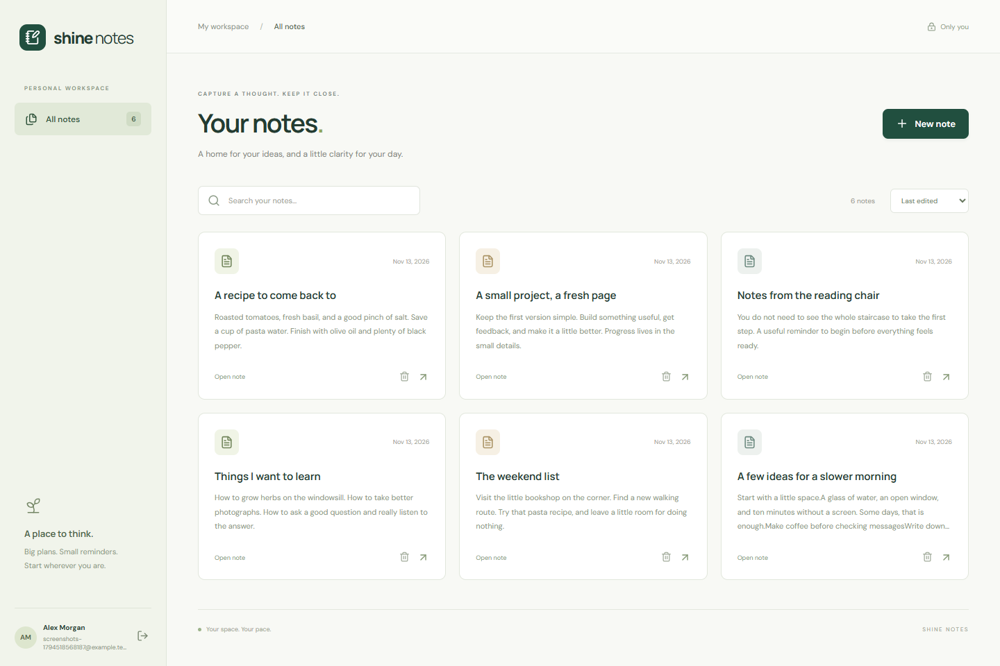
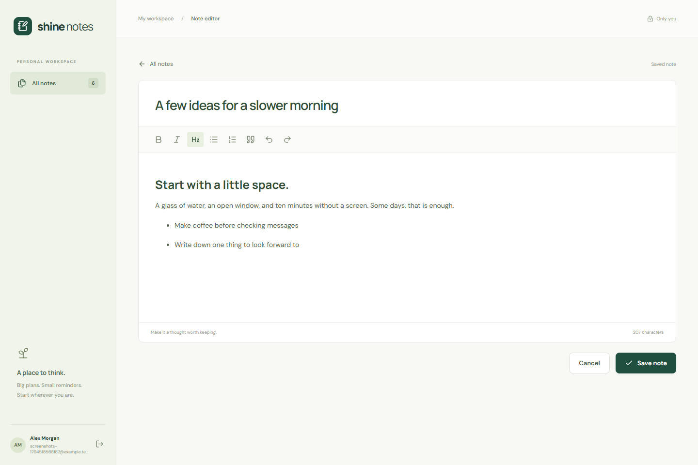
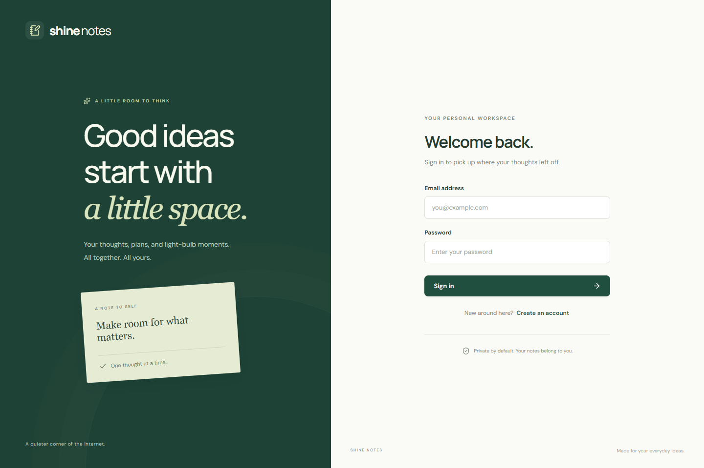

# Shine Notes

A private notes workspace for the 10Pearls Shine Cohort 10 assignment. Built with TypeScript, React, Express, PostgreSQL, and Pino.

Register or sign in, write rich text notes, and return to them from a searchable dashboard. Notes belong to the signed-in user. The editor supports headings, bold, italic, lists, quotes, and undo/redo. Saving is explicit; cancel leaves the saved version alone. Deletion asks for confirmation.

## Screens

The running app with synthetic demo data and an embedded PostgreSQL test database:

Your notes, search, sorting, and account details.

A focused editor with save and cancel controls.

Sign in or create a private workspace. [Mobile dashboard](docs/screenshots/mobile.png).

## Run locally

Requires Node.js 24 or newer and PostgreSQL 17. Docker Compose can provide PostgreSQL.

1. Run `npm ci` in the repository root.
2. Copy `.env.example` to `.env`. The example password is for local development; change it before any deployment.
3. Run `docker compose up -d db`, or point `DATABASE_URL` at your own PostgreSQL instance.
4. Run `npm run db:migrate`.
5. Run `npm run dev` and open http://localhost:5173.

The API defaults to port 3001. Vite proxies `/api` to the configured `PORT`. `APP_ORIGIN` must match the browser origin exactly, without a trailing slash. Update `DATABASE_URL` when changing the Compose database port or credentials. Migrations are idempotent and create users, sessions, and notes with foreign keys and indexes.

For a production build, run `npm run build`, then `npm start`. Express serves the built frontend. Set `NODE_ENV=production`, an HTTPS `APP_ORIGIN`, and your database connection. Put the app behind an HTTPS reverse proxy that preserves the browser Origin header. Production session cookies require HTTPS. No deployment is included.

## Checks

`npm run typecheck` checks both workspaces. `npm test` runs backend Mocha/Chai and frontend Jest tests. `npm run coverage` writes LCOV reports for SonarQube. `npm run format:check` checks formatting.

For browser checks, run `npm run build`, `npx playwright install chromium`, and `npm run test:e2e`. These tests start a temporary app with PGlite, which executes PostgreSQL SQL in-process. They exercise registration, rich text, save/cancel, search, reload persistence, deletion, and logout, and refresh the screenshots. PGlite tests do not verify a TCP connection to a separate PostgreSQL server. The test server is separate from the normal application entry point and cannot be enabled through production configuration.

## SonarQube

Run `docker compose --profile quality up -d sonarqube` and open http://localhost:9000. Complete the local first-login setup, create a project with key `shine-notes`, and select the built-in Sonar way profiles for JavaScript and TypeScript. Generate a project analysis token locally and set `SONAR_TOKEN` in your shell. Do not commit it.

After `npm run coverage`, run `docker compose --profile quality run --rm sonar-scanner`. The scanner imports both LCOV reports and waits for the quality gate. This local SonarQube configuration uses its embedded database for evaluation; it is not a production SonarQube deployment. Configuration alone does not establish a passing analysis. A running Docker engine and a successful scan are required.

## API and security

Authentication endpoints: `POST /api/auth/register`, `POST /api/auth/login`, `POST /api/auth/logout`, and `GET /api/auth/me`. Notes: `GET/POST /api/notes` and `GET/PUT/DELETE /api/notes/:id`. Note bodies contain `title` and HTML `content`. State-changing requests require an Origin matching `APP_ORIGIN`. Errors return `error` and a request ID.

Passwords use salted scrypt hashes. Random session tokens live in HttpOnly cookies; only SHA-256 token hashes are stored. Logout deletes the session. Queries use parameters, and every note query includes the authenticated user ID. Rich text uses a server-side allowlist. Pino records requests, responses, authentication, note activity, and failures without logging credentials or note bodies. Authentication attempts are rate-limited. Global middleware returns safe errors.

## Assignment workflow

Work lives on the `assignment` branch of the personal fork. Submit a pull request to the original cohort repository, resolve HIGH and CRITICAL CodeRabbit findings, then assign the mentor for review. GitHub Actions runs compilation, coverage, formatting, and browser checks. The mentor identity and portal submission fields must come from the programme.

For a separate PostgreSQL connection check, run `npm run db:migrate` and `npm run test:postgres` with your local database running. It creates a synthetic account, checks authentication and CRUD over TCP, then removes only that account and its records.

The SonarQube analysis workflow starts a temporary Community Build server on its GitHub runner, scans with the default Sonar way profiles, checks the quality gate, and uploads issue, hotspot, coverage, and gate reports as the `sonarqube-analysis` artifact. It removes the temporary server when the scan ends and uses no external SonarQube account.
